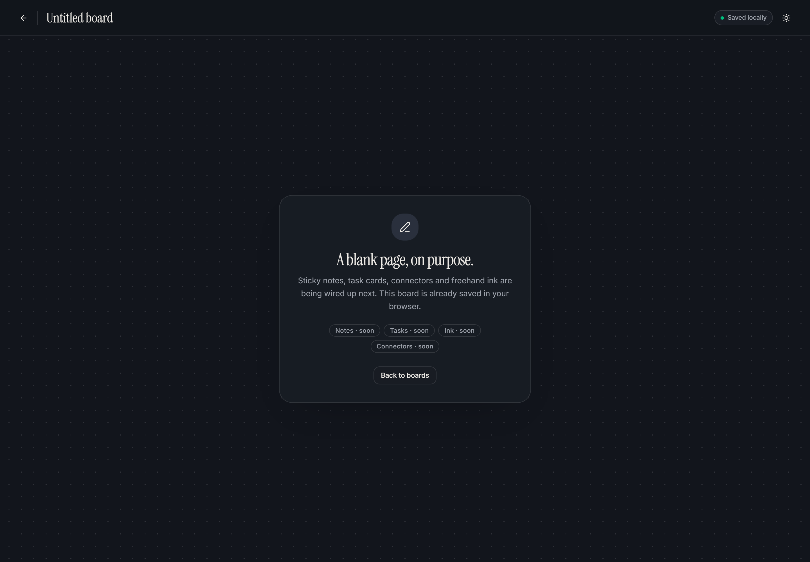

<div align="center">

# Kanvas

**Rencana, orat-oret & ide dalam satu kanvas tak terbatas.**

Ruang kerja gratis dan open source untuk menyusun rencana, mencatat kasar, dan brainstorming.
Tanpa akun. Tanpa cloud. Semua tersimpan di browser kamu.

[Demo](https://hugoagfarizky.github.io/kanvas/) · [Roadmap](ROADMAP.md) · [Kontribusi](CONTRIBUTING.md)

</div>

> Antarmuka aplikasi berbahasa Inggris. Dokumen ini menjelaskan proyek dalam bahasa Indonesia.

## Kenapa Kanvas

Kebanyakan whiteboard dibuat untuk rapat. Kanvas dibuat untuk bagian kerja yang paling berantakan:
rencana setengah jadi, coretan di belakang kertas, dan ide yang harus dilihat dulu sebelum masuk
akal.

- **Rencana** — kartu tugas, checklist, dan frame _sekarang / nanti / selesai_.
- **Orat-oret** — pena, highlighter, dan penghapus untuk coretan bebas.
- **Brainstorm** — sticky note dan konektor berlabel dalam satu halaman.
- **Local-first** — board disimpan di IndexedDB, tetap jalan offline, tanpa pendaftaran.
- **Bebas** — lisensi MIT, bisa dipelajari, dimodifikasi, dan di-host sendiri.

## Status

Kanvas masih tahap awal. **M0 selesai**: kerangka aplikasi, penyimpanan board lokal, template, mode
gelap/terang, dan deploy GitHub Pages. Mesin kanvas adalah milestone berikutnya — lihat
[ROADMAP.md](ROADMAP.md).



## Menjalankan secara lokal

Butuh Node.js 22+ (disarankan 24) dan npm 10+.

```bash
git clone https://github.com/Hugoagfarizky/kanvas.git
cd kanvas
npm install
npm run dev
```

Buka <http://localhost:5173>.

| Perintah         | Fungsi                          |
| ---------------- | ------------------------------- |
| `npm run dev`    | Server pengembangan             |
| `npm run build`  | Typecheck lalu build ke `dist/` |
| `npm run lint`   | ESLint                          |
| `npm test`       | Unit test                       |
| `npm run format` | Format dengan Prettier          |

## Privasi

Tidak ada backend. Board tersimpan di IndexedDB browser dengan nama database `kanvas`. Menghapus
data situs akan menghapus board, karena itu export/import JSON direncanakan di M5.

## Kontribusi

Semua bentuk kontribusi diterima: kode, dokumentasi, terjemahan, laporan bug, dan ide template.
Baca [CONTRIBUTING.md](CONTRIBUTING.md), lalu cari issue berlabel `good first issue`.

## Lisensi

[MIT](LICENSE) © 2026 Hugo Agfarizky
