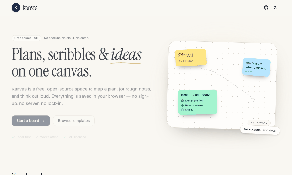
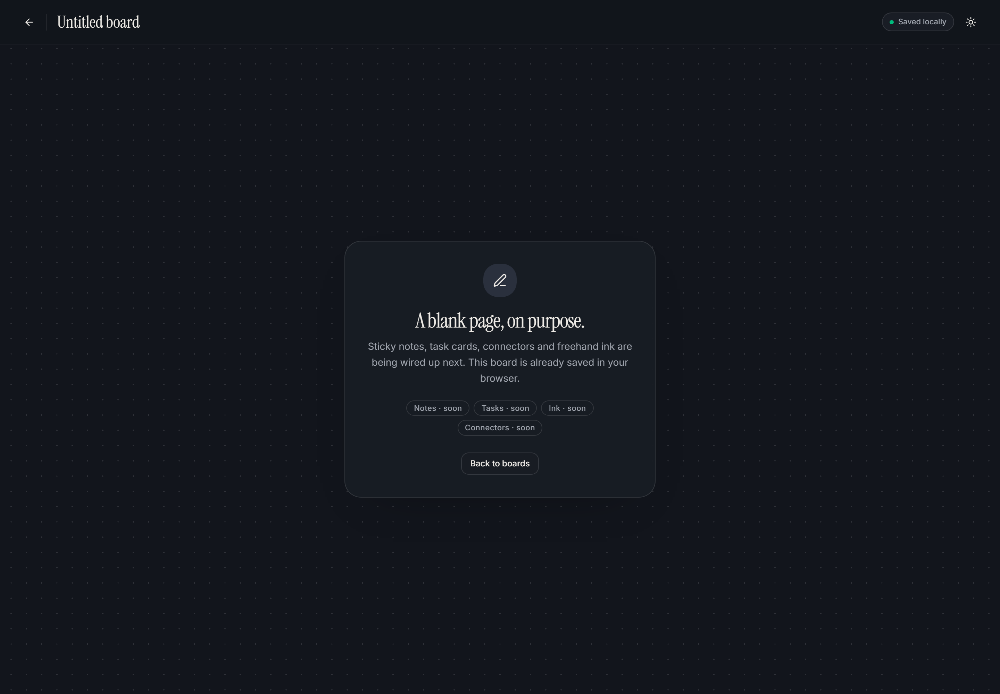

<div align="center">

# Kanvas

**Plans, scribbles & ideas on one infinite canvas.**

A free, open-source workspace to map a plan, sketch rough notes, and brainstorm out loud.
No account. No cloud. Everything stays in your browser.

[Live demo](https://hugoagfarizky.github.io/kanvas/) · [Roadmap](ROADMAP.md) · [Contributing](CONTRIBUTING.md)

[](https://github.com/Hugoagfarizky/kanvas/actions/workflows/ci.yml)
[](https://github.com/Hugoagfarizky/kanvas/actions/workflows/deploy.yml)
[](LICENSE)
[](CONTRIBUTING.md)

</div>

<picture>
  <source media="(prefers-color-scheme: dark)" srcset="docs/screenshot-dark.png">
  
</picture>



## Canvas Features & Reference Dashboards

Kanvas provides an infinite creative surface for brainstorming, sketching, planning, clinical tracking, and UX architecture. Everything is accessible via the top floating dock, context menus, and keyboard shortcuts.

### 1. Dei Learning Plan & Events (Reference 3 & 4)
- **Roadmap Bento Cards**:
  - Interactive objective steps (`Medical Terminology`, `Anatomy and Physiology`, `Medical Ethics and Professionalism`, `Disease Pathophysiology`).
  - Top-right circular mint badge (`+`, `🧠`, `🩺`, `🔬`): Click to cycle icons.
  - Interactive status pill: Toggle between `Completed 🌿` and `Upcoming 🕒`.
  - Action dots: `···` cycle tags, `✕` delete step, `✓` quick toggle done.
- **Tilted Lilac Media Course Card (`Pharmacology Basics`)**:
  - Tilted at -8° with animated audio play button and pulsing glowing ring.
  - Duration pill (`🎧 Watching 00:30`) and trio avatar stack (`👦👧🧔`).
- **Schedule Events Stack (`My Events 🫡`)**:
  - Right-aligned pastel event cards: `Webinar` (Sky blue with time badge), `Lesson` (Lilac), `Task` (Butter yellow & Mint green).
- **Emerald Dotted Connectors**:
  - Custom `#10b981` green dotted paths connecting roadmap steps with smooth curves.
- **Dynamic Bento Stats Island**:
  - Floating top center pill with live Search and 3 Bento stat counters: `Total`, `Completed 🎉`, `Upcoming`. Clicking stats dims non-matching cards for instant focus.

### 2. Cardiology Treatment Dynamics (Reference 1)
- **Patient Vitals Banner**:
  - Patient card for `Tiffany Woodward` (Female, 24) with diagnosis `Hypertension`.
  - 4 Vitals chips: Heart Rate (`89 bpm`), Blood Pressure (`100/67`), Oxygen (`98%`), and Temperature (`36.8°C`).
  - 6 Category filter pills: `Office Visits`, `Medications`, `Labs`, `Procedures`, `Hospitalizations`, `Imaging`.
- **Medication Capsule Pills**:
  - Dark pill badges with capsule icons: `Aspirin x2` and `Bisoprolol x3`.
- **Dynamic Blood Pressure Curves**:
  - Yellow and grey wave charts with systolic/diastolic values, weekly averages, and delta tags (`+10 ↗` / `-20 ↘`).
- **Symptoms Card**:
  - Human body silhouette with highlighted chest pain point and `Headache reported` tag.
- **Live ECG Cardiac Rhythm Card**:
  - Real ECG sinus rhythm wave with pulsating heart icon and Lead II 25mm/s indicator.
- **Month Timeline Scrubber**:
  - Bottom timeline bar with calendar icon, `Jan 2022` through `Sep`, and notification badges (`Aug (3)`, `Sep (6)`).

### 3. UX Architecture Flow (Reference 2: Figma Style)
- **Decision Tree & Start Node**:
  - Centered blue pill `Sign up example` branching into two decision paths.
- **Interactive Wireframe Form Cards**:
  - `Create a company workspace`: Instructions, personal info fields (`Name`, `Surname`, `Email`, `Phone number`, `Password`), primary `Sign up` button, and social sign-in buttons (`Google`, `Facebook`).
  - `Join your company workspace`: `E-mail` input and `Join` button.
  - `Email is found`: Dialog card with `Resend the link` button.
- **Blue Curved Arrow Connectors**:
  - Blue bezier spline connectors (`#3b82f6`) with closed arrowheads.

### 4. Interactive Left Dock & Figma Layers Panel
- **Total Items Badge**: Live count of cards and elements on canvas.
- **Figma-Style Layers Drawer (`≡`)**:
  - Tree view with `Page 1 ▾`, `+ Add Layer`, and node type icons.
  - One-click canvas centering: Click any layer to smoothly pan and zoom to it.
  - Per-node visibility toggle (`Eye` / `EyeOff`) to hide/show nodes.
  - Per-node lock toggle (`Lock` / `Unlock`) to freeze nodes in place.
- **Template & View Switcher (`⊞`)**:
  - Instantly load **Dei Learning Plan**, **Cardiology Dynamics**, **UX Architecture Flow**, or **Clean Canvas**.
  - Canvas grid background switcher (`Dots`, `Lines`, `Clean`).
- **Activity & Reminders Modal (`🔔`)**:
  - Upcoming activities and milestones with direct **Focus** jump buttons.
  - Keyboard shortcuts reference guide.
- **Smooth Zoom Controls**:
  - Quick `+` and `-` zoom steps.

### 5. Sculpted Bottom Dock & Quick Add Tools
- **7 Circular Color-Coded Tools**:
  1. `T` (Lilac): Text note block.
  2. `A` (Sky blue): Roadmap objective Bento card.
  3. `🎴` (Pink): Media / Audio lecture course card.
  4. `📋` (Yellow): Event / Schedule card.
  5. `💬` (Teal): Comment note.
  6. `🎯` (Mint): Milestone shape node.
  7. `+` (Dark): Quick Add popover (primitives, device image upload, pen, highlighter, template switchers).
- **Canvas Lock Toggle**: Dedicated padlock button to freeze canvas pan and drag.
- **Maximize Button (`⤢`)**: Bottom-right circular button to fit and center all board elements on screen (`0`).

### 6. Drawing, Connectors & Media Tools

## Status

Kanvas is in early development. **M0 is live**, and the local workspace already supports a few pieces that
used to be on later milestones: board search, duplicate, JSON import/export with undoable delete, a toast
system, an error boundary, and offline use as a PWA. **M4 connectors and ink are live too**: labeled connectors by dragging between node handles (double-click to
label), plus pen, highlighter and eraser with perfect-freehand strokes and a geometry-based eraser. The
canvas now supports the full M1-M4 loop — see [ROADMAP.md](ROADMAP.md) for M5+ (persistence polish and
templates).



## Tech stack

| Layer        | Choice                                                                                                      |
| ------------ | ----------------------------------------------------------------------------------------------------------- |
| UI           | React 19, TypeScript, Tailwind CSS v4, shadcn/ui conventions                                                |
| Build        | Vite                                                                                                        |
| Canvas (M1+) | [React Flow](https://reactflow.dev) and [perfect-freehand](https://github.com/steveruizok/perfect-freehand) |
| State (M1+)  | React hooks + refs (no external state library)                                             |
| Storage      | IndexedDB via `idb-keyval` (one record per board + index)                                 |
| Tests        | Vitest, Testing Library, Playwright                                                                         |
| Hosting      | GitHub Pages (static, free)                                                                                 |

## Getting started

Requirements: Node.js 22 or newer (24 recommended) and npm 10+.

```bash
git clone https://github.com/Hugoagfarizky/kanvas.git
cd kanvas
npm install
npm run dev
```

Open <http://localhost:5173>. The app is a hash-routed SPA, so no server is required.

### Scripts

| Command             | Description                       |
| ------------------- | --------------------------------- |
| `npm run dev`       | Start the dev server              |
| `npm run build`     | Typecheck and build to `dist/`    |
| `npm run preview`   | Preview the production build      |
| `npm run lint`      | Run ESLint                        |
| `npm run typecheck` | Run TypeScript project references |
| `npm test`          | Run the unit tests once           |
| `npm run test:e2e`  | Run the Playwright smoke tests    |
| `npm run format`    | Format with Prettier              |

## Project structure

```text
src/
├─ components/      # UI primitives, header, hero, cards
├─ pages/           # Dashboard, board, 404
├─ lib/             # storage, ids, dates, templates, theme
├─ types/           # board schema (nodes, edges, strokes)
└─ test/            # Vitest setup
.github/workflows/  # CI + GitHub Pages deployment
docs/               # Screenshots
```

The board schema lives in [`src/types/board.ts`](src/types/board.ts). Coordinates are stored in
canvas space, not screen space, so future pan/zoom work will not misplace objects. Every board
carries a `schemaVersion` for migrations.

## Privacy

Kanvas does not have a backend and does not upload your boards. Data lives in your browser's
IndexedDB under the `kanvas` database. Clearing site data removes your boards, so export a JSON backup
from the board header when you want to keep one. Boards can be imported again from the dashboard.

## Contributing

Contributions of all sizes are welcome — code, docs, translations, bug reports and template ideas.
Start with [CONTRIBUTING.md](CONTRIBUTING.md) and look for issues labeled `good first issue`.

## License

[MIT](LICENSE) © 2026 Hugo Agfarizky
