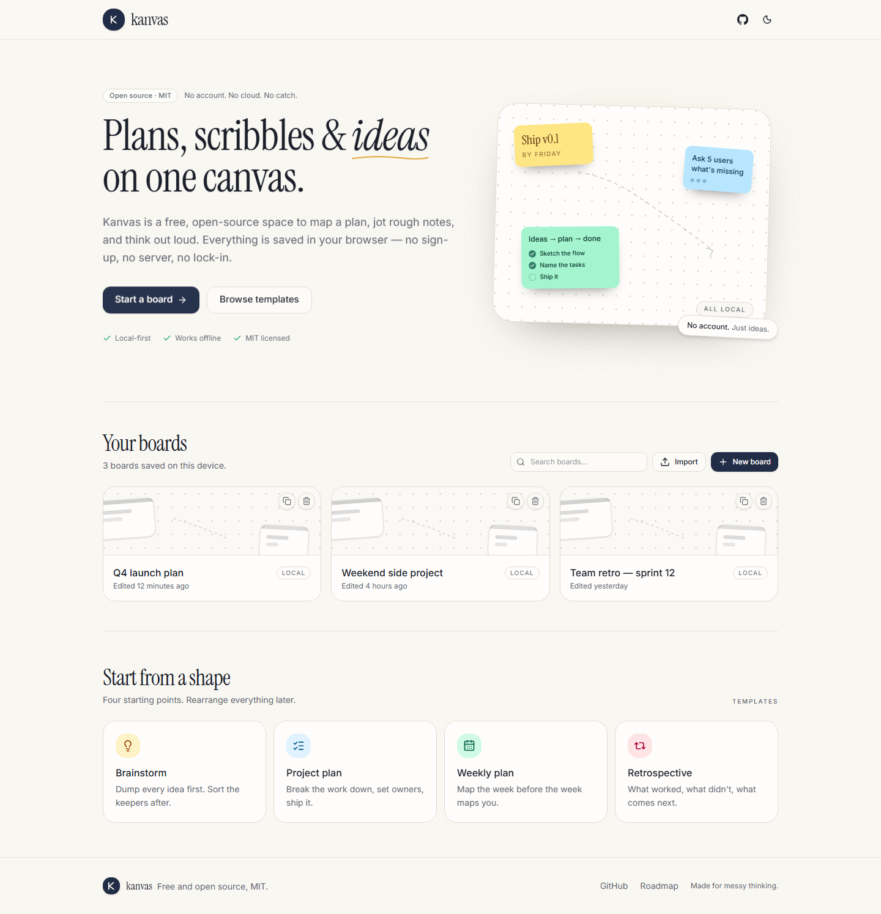

<div align="center">

# Kanvas

**Plans, scribbles & ideas on one infinite canvas.**

A free, open-source workspace to map a plan, sketch rough notes, and brainstorm out loud.
No account. No cloud. Everything stays in your browser.

[Live demo](https://hugoagfarizky.github.io/kanvas/) · [Roadmap](ROADMAP.md) · [Contributing](CONTRIBUTING.md)

[](https://github.com/Hugoagfarizky/kanvas/actions/workflows/ci.yml)
[](https://github.com/Hugoagfarizky/kanvas/actions/workflows/deploy.yml)
[](LICENSE)
[](CONTRIBUTING.md)

</div>

<picture>
  <source media="(prefers-color-scheme: dark)" srcset="docs/screenshot-dark.png">
  
</picture>


## Why Kanvas

Most whiteboards are built for meetings. Kanvas is built for the messy middle of work: the
half-formed plan, the scribble on the back of a napkin, the idea you need to see before it makes
sense.

- **Plan** — task cards, checklists and frames for _now / next / later_.
- **Scribble** — pen, highlighter and eraser for the rough stuff.
- **Brainstorm** — sticky notes and labeled connectors, without leaving the page.
- **Local-first** — boards are saved in IndexedDB. Works offline, no sign-up.
- **Yours** — MIT licensed, hackable, and self-hostable.

## Status

Kanvas is in early development. **M0 is live**, and the local workspace already supports a few pieces that
used to be on later milestones: board search, duplicate, JSON import/export with undoable delete, a toast
system, an error boundary, and offline use as a PWA. **M4 connectors and ink are live too**: labeled connectors by dragging between node handles (double-click to
label), plus pen, highlighter and eraser with perfect-freehand strokes and a geometry-based eraser. The
canvas now supports the full M1-M4 loop — see [ROADMAP.md](ROADMAP.md) for M5+ (persistence polish and
templates).


## Tech stack

| Layer        | Choice                                                                                                      |
| ------------ | ----------------------------------------------------------------------------------------------------------- |
| UI           | React 19, TypeScript, Tailwind CSS v4, shadcn/ui conventions                                                |
| Build        | Vite                                                                                                        |
| Canvas (M1+) | [React Flow](https://reactflow.dev) and [perfect-freehand](https://github.com/steveruizok/perfect-freehand) |
| State (M1+)  | Zustand                                                                                                     |
| Storage      | IndexedDB via `idb-keyval`                                                                                  |
| Tests        | Vitest, Testing Library, Playwright                                                                         |
| Hosting      | GitHub Pages (static, free)                                                                                 |

## Getting started

Requirements: Node.js 22 or newer (24 recommended) and npm 10+.

```bash
git clone https://github.com/Hugoagfarizky/kanvas.git
cd kanvas
npm install
npm run dev
```

Open <http://localhost:5173>. The app is a hash-routed SPA, so no server is required.

### Scripts

| Command             | Description                       |
| ------------------- | --------------------------------- |
| `npm run dev`       | Start the dev server              |
| `npm run build`     | Typecheck and build to `dist/`    |
| `npm run preview`   | Preview the production build      |
| `npm run lint`      | Run ESLint                        |
| `npm run typecheck` | Run TypeScript project references |
| `npm test`          | Run the unit tests once           |
| `npm run test:e2e`  | Run the Playwright smoke tests    |
| `npm run format`    | Format with Prettier              |

## Project structure

```text
src/
├─ components/      # UI primitives, header, hero, cards
├─ pages/           # Dashboard, board, 404
├─ lib/             # storage, ids, dates, templates, theme
├─ types/           # board schema (nodes, edges, strokes)
└─ test/            # Vitest setup
.github/workflows/  # CI + GitHub Pages deployment
docs/               # Screenshots
```

The board schema lives in [`src/types/board.ts`](src/types/board.ts). Coordinates are stored in
canvas space, not screen space, so future pan/zoom work will not misplace objects. Every board
carries a `schemaVersion` for migrations.

## Privacy

Kanvas does not have a backend and does not upload your boards. Data lives in your browser's
IndexedDB under the `kanvas` database. Clearing site data removes your boards, so export a JSON backup
from the board header when you want to keep one. Boards can be imported again from the dashboard.

## Contributing

Contributions of all sizes are welcome — code, docs, translations, bug reports and template ideas.
Start with [CONTRIBUTING.md](CONTRIBUTING.md) and look for issues labeled `good first issue`.

## License

[MIT](LICENSE) © 2026 Hugo Agfarizky
